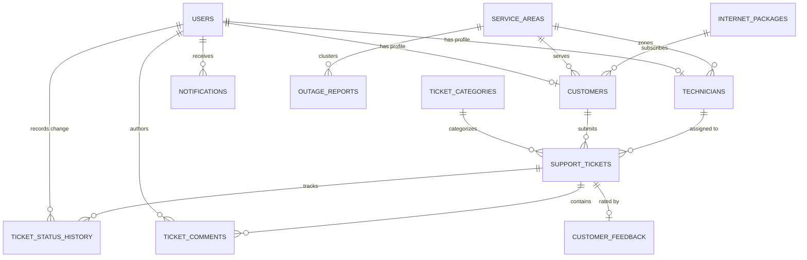

# NetCare – Smart ISP Customer Support & Complaint Management System

[](https://fastapi.tiangolo.com)
[](https://www.python.org/)
[](https://www.sqlalchemy.org/)
[](https://docs.pydantic.dev/)
[](LICENSE)

> A production-oriented, role-based ISP Support and Complaint Lifecycle Management SaaS engineered specifically for Internet Service Provider (ISP) business operations in Bangladesh.

---

## 1. Executive Summary / Project Overview

### 1.1 Purpose & Problem Statement
Traditional helpdesk platforms (e.g., Zendesk, Jira Service Desk) are generic ticket trackers that lack domain knowledge of broadband operations, Fiber-To-The-Home (FTTH) line parameters, and Bangladeshi ISP field dispatch workflows. When fiber cuts, switch reboots, or optical power degradation occur, traditional helpdesks result in:
* **Duplicate Field Dispatches**: Multiple home visits scheduled for what is actually an upstream backbone cut.
* **Lack of Accountability**: Technicians closing tickets with arbitrary notes without customer verification.
* **Customer Churn**: Long, uncommunicative resolution times and lack of real-time complaint visibility.

**NetCare** solves this by providing a unified operational platform built directly around the day-to-day operations of an ISP.

### 1.2 Target User Roles & Permissions

NetCare enforces strict Role-Based Access Control (RBAC) across four operational tiers:

```
+-----------------------------------------------------------------------------------+
|                                  NETCARE RBAC                                     |
+-----------------------------------------------------------------------------------+
|  [👑 ADMIN]       - Full system oversight, executive analytics, outage governance|
|  [🎧 AGENT]       - Ticket triage, customer lookup, manual technician dispatch    |
|  [🛠 TECHNICIAN]  - Field work orders, live duty status, on-site resolution notes |
|  [👤 CUSTOMER]    - Complaint filing, live 4-stage stepper tracking, CSAT reviews |
+-----------------------------------------------------------------------------------+
```

* **👑 Administrator (`ADMIN`)**:
  * Complete operational overview via executive KPI analytics dashboard.
  * ISP infrastructure management: service areas, bandwidth packages, technician fleets.
  * Network outage confirmation and operational dispatch oversight.
  * User account management and permission enforcement.
* **🎧 Support Agent (`AGENT`)**:
  * Triage incoming customer complaints and tickets.
  * Create tickets on behalf of calling subscribers.
  * Assign tickets to active field technicians.
  * Track unresolved complaints, monitor SLAs, and post internal staff updates.
* **🛠 Field Technician (`TECHNICIAN`)**:
  * View personal dispatched queue on a mobile-friendly field console.
  * Access subscriber technical profiles: ONU MAC, assigned IP, physical installation address.
  * Real-time duty toggle (`AVAILABLE`, `ON_JOB`, `OFF_DUTY`).
  * Transition tickets to `IN_PROGRESS` and submit mandatory resolution notes for verification.
* **👤 Customer / Subscriber (`CUSTOMER`)**:
  * Self-service portal with one-click issue reporting across standardized ISP symptom categories.
  * Real-time 4-stage visual progress stepper (`Reported` → `Assigned` → `In Progress` → `Resolved`).
  * Reopen tickets if issues persist; rate completed service (1–5 stars) with CSAT comments.
  * Instant area outage detection banners alerting them before they need to file duplicate tickets.

---

## 2. Tech Stack & Architecture

### 2.1 Backend Architecture
The backend is built with **Python** and **FastAPI**, adhering to clean architecture, dependency injection, and RESTful principles:

* **Framework**: [FastAPI](https://fastapi.tiangolo.com) for asynchronous, high-throughput REST API endpoints with auto-generated OpenAPI (Swagger) documentation.
* **Validation & Serialization**: [Pydantic v2](https://docs.pydantic.dev) schemas enforcing strict runtime input validation and response shaping.
* **Object-Relational Mapping**: [SQLAlchemy 2.0](https://www.sqlalchemy.org) with typed Declarative Models, explicit relationships, and foreign key cascades.
* **Database Agnostic**:
  * **Local Development**: SQLite (zero-config, self-contained `netcare.db`).
  * **Production Deployment**: PostgreSQL 15+ via Docker Compose.
* **Database Migrations**: [Alembic](https://alembic.sqlalchemy.org/) managing versioned database schema migrations.
* **Security & Auth**:
  * Native `bcrypt` password hashing (free of Python 3.14 deprecation issues).
  * JWT (JSON Web Tokens) with HS256 encryption.
  * Role-based dependency injection guards (`get_current_user`, `require_role`).

### 2.2 Frontend Architecture
The frontend is built as a zero-dependency, modern Single Page Application (SPA):

* **Core Stack**: Semantic HTML5, Modular CSS3, and Vanilla JavaScript (ES6+ Modules).
* **Zero Build Step Friction**: Runs directly in any modern browser without requiring Node.js, Webpack, or npm builds.
* **Design System & Visual Tokens**:
  * Primary: `#1E3A8A` (Deep Navy)
  * Secondary: `#2563EB` (Royal Blue)
  * Accent / Alert: `#F59E0B` (Amber)
  * Success: `#16A34A` (Emerald Green)
  * Danger: `#DC2626` (Crimson Red)
  * Surfaces: `#FFFFFF` (Surface) & `#F8FAFC` (Page Background)
  * Text: `#1E293B` (Slate Dark)
* **Responsive Layout Engine**:
  * **Desktop (> 1024px)**: Sticky sidebar navigation, multi-column analytics grids, full data tables.
  * **Tablet (768px – 1024px)**: 2-column adaptive KPI cards, touch-scrollable horizontal tab bars.
  * **Mobile (< 768px)**: Off-canvas sliding drawer menu (`☰`), single-column card layouts, horizontal touch-scrolling data tables, single-line auto-truncating top navigation bar (`#page-title`), and 16px iOS auto-zoom prevention.

### 2.3 Directory Structure

```text
netcare/
├── Dockerfile                       # Multi-stage production container build
├── docker-compose.yml               # PostgreSQL 15 + FastAPI app orchestration
├── requirements.txt                 # Pinned Python backend dependencies
├── alembic.ini                      # Database migration configuration
├── start_server.bat                 # 1-click Windows server launch script
├── alembic/                         # Version-controlled schema migrations
│   ├── env.py
│   └── versions/
├── app/
│   ├── main.py                      # FastAPI app entry point & static mounts
│   ├── core/
│   │   ├── config.py                # Pydantic Settings & environment variables
│   │   ├── security.py              # Native bcrypt hashing & JWT token issuance
│   │   └── dependencies.py          # FastApi RBAC auth guards
│   ├── db/
│   │   ├── session.py               # Engine & sessionmaker factory
│   │   ├── base.py                  # Declarative base registry
│   │   └── init_db.py               # Seed data for BD ISP areas, packages & users
│   ├── models/                      # SQLAlchemy ORM database models
│   │   ├── user.py
│   │   ├── customer.py
│   │   ├── technician.py
│   │   ├── service_area.py
│   │   ├── package.py
│   │   ├── ticket.py
│   │   ├── category.py
│   │   ├── status_history.py
│   │   ├── comment.py
│   │   ├── feedback.py
│   │   ├── outage.py
│   │   └── notification.py
│   ├── schemas/                     # Pydantic validation schemas
│   ├── services/                    # Domain logic (State Machine, Outage Correlator)
│   │   ├── ticket_service.py
│   │   └── outage_service.py
│   └── api/v1/endpoints/            # API Route Controllers
│       ├── auth.py
│       ├── customers.py
│       ├── technicians.py
│       ├── areas.py
│       ├── packages.py
│       ├── categories.py
│       ├── tickets.py
│       ├── outages.py
│       └── analytics.py
├── frontend/                        # Modular Vanilla SPA
│   ├── index.html                   # Shell container (Navbar, Sidebar Drawer, Main)
│   ├── css/
│   │   ├── variables.css            # Color tokens, typography, radii, transitions
│   │   ├── base.css                 # Reset, utility classes, typography
│   │   ├── components.css           # Cards, buttons, tables, badges, modals, toasts
│   │   └── layouts.css              # App shell, responsive breakpoints, drawer nav
│   └── js/
│       ├── app.js                   # Client-side hash router & route guards
│       ├── config.js                # Frontend constants & API endpoint mapping
│       ├── services/                # API client, JWT Auth storage, Toast alerts
│       ├── components/              # Reusable UI: Navbar, Sidebar, Modal, Badges
│       └── views/                   # Views (Dashboard, Tickets, Details, Portal)
└── tests/
    └── test_full_suite.py           # Comprehensive 7-stage automated E2E test suite
```

---

## 3. Database Models & Relationships

NetCare implements a fully normalized relational schema designed for PostgreSQL and SQLite.



### Core Entities Breakdown

1. **`User` (`users`)**:
   Core authentication account storing email, phone number, hashed password, and role (`ADMIN`, `AGENT`, `TECHNICIAN`, `CUSTOMER`).
2. **`Customer` (`customers`)**:
   Broadband subscriber details linked to a user account. Stores auto-generated `customer_code` (e.g., `NC-CUST-1001`), `service_area_id`, `package_id`, physical `installation_address`, static `ip_address`, `onu_mac_address`, and line status (`ACTIVE`, `SUSPENDED`, `TERMINATED`).
3. **`Technician` (`technicians`)**:
   Field engineer profiles linked to a user account. Stores `employee_code` (e.g., `NC-TECH-01`), `primary_area_id`, technical `specialization` (e.g., *Fiber Splicing & Optical Line Test*), live status (`AVAILABLE`, `ON_JOB`, `OFF_DUTY`), and cached CSAT rating.
4. **`ServiceArea` (`service_areas`)**:
   Network coverage zones (e.g., *Dhanmondi (DHA-01)*, *Mirpur-10 (MIR-10)*, *Gulshan & Banani (GUL-01)*).
5. **`InternetPackage` (`packages`)**:
   Broadband tiers defining bandwidth speeds (Mbps), monthly fees (BDT), and connection types.
6. **`SupportTicket` (`tickets`)**:
   Central complaint entity storing unique code (e.g., `NC-2026-00001`), customer info, problem category, priority (`CRITICAL`, `HIGH`, `MEDIUM`, `LOW`), lifecycle status, assigned technician, SLA target, and mandatory resolution details.
7. **`TicketCategory` (`categories`)**:
   ISP complaint types (e.g., *Internet Not Working*, *Slow Internet Speed*, *Router Problem*, *Optical Fiber Cut*) with defined SLA targets.
8. **`TicketStatusHistory` (`ticket_status_history`)**:
   Immutable audit log capturing every state transition: previous status, new status, actor ID, timestamp, and justification reason.
9. **`TicketComment` (`ticket_comments`)**:
   Communication stream supporting public customer updates and private internal staff notes.
10. **`CustomerFeedback` (`customer_feedback`)**:
    Post-resolution review storing 1–5 star rating, confirmation of whether the issue was resolved, and subscriber comments.
11. **`OutageReport` (`outage_reports`)**:
    Incident record flagged automatically by the temporal correlation engine when $\ge 3$ connection tickets cluster in the same area within 30 minutes.

---

## 4. How It Works / Operational Workflow Guide

### 4.1 Strict 7-Stage Ticket Lifecycle State Machine
NetCare enforces a strict lifecycle to eliminate unverified closures:

```
    [ NEW ]  (Customer / Agent opens ticket)
       │
       ▼
  [ ASSIGNED ]  (Agent / Admin assigns Field Technician)
       │
       ▼
 [ IN PROGRESS ]  (Technician arrives & starts diagnostics)
       │
       ├─────────────────────────────────┐
       ▼                                 ▼
 [ WAITING FOR CUSTOMER ]          [ RESOLVED ]  (Tech submits verified notes)
       │                                 │
       └───────────────┬─────────────────┘
                       │
       ┌───────────────┴───────────────┐
       ▼                               ▼
   [ CLOSED ]                     [ REOPENED ]
(Customer accepts & rates)     (Issue unresolved; escalated)
```

1. **New (`NEW`)**: Customer submits an issue or an Agent opens a ticket on customer's behalf.
2. **Assigned (`ASSIGNED`)**: Dispatcher assigns a technician. Technician's duty status updates to `ON_JOB`.
3. **In Progress (`IN_PROGRESS`)**: Technician marks work started upon arrival at customer premises.
4. **Waiting for Customer (`WAITING`)**: Paused state if technician requires customer presence/access.
5. **Resolved (`RESOLVED`)**: Technician documents official resolution notes (e.g., *Re-spliced loose drop fiber at distribution box*). Ticket cannot be resolved without notes.
6. **Closed (`CLOSED`)**: Subscriber confirms fix, rates technician 1–5 stars, and closes ticket.
7. **Reopened (`REOPENED`)**: If connection remains down, customer reopens ticket with reason; priority escalates automatically.

### 4.2 Area Outage Correlation Engine
* The system monitors incoming tickets in real-time.
* If $\ge 3$ connection failure tickets are filed in the same `service_area_id` within a sliding 30-minute window:
  1. An incident is generated (`OUT-YYYY-XXXX`) in `SUSPECTED` status.
  2. An incident notification banner displays on the Admin and Agent consoles.
  3. Affected customers in that zone see an informative alert in their portal, preventing duplicate complaint filing.
  4. Once confirmed by an Admin, field crews are dispatched to the distribution point rather than individual homes.

---

## 5. Setup & Deployment Guide

### 5.1 Prerequisites
* **Python**: Version 3.11 or higher (Python 3.14 fully supported).
* **Git**: Installed and available in PATH.
* **Operating System**: Windows 10/11, macOS, or Linux.

---

### 5.2 Local Development Setup (Quickest)

#### Step 1: Clone the Repository
```powershell
git clone https://github.com/your-org/netcare.git
cd netcare
```

#### Step 2: Create and Activate Virtual Environment
```powershell
# Windows (PowerShell)
python -m venv venv
.\venv\Scripts\activate

# Linux / macOS
python3 -m venv venv
source venv/bin/activate
```

#### Step 3: Install Dependencies
```powershell
pip install -r requirements.txt
```

#### Step 4: Seed Database
```powershell
python -m app.db.init_db
```
*This initializes the SQLite database (`netcare.db`) and seeds master service areas, bandwidth packages, complaint categories, and demo accounts.*

#### Step 5: Start the Server
You can launch the server using the provided Windows script:
```powershell
.\start_server.bat
```
Or start Uvicorn directly:
```powershell
uvicorn app.main:app --host 0.0.0.0 --port 8000 --reload
```

#### Step 6: Access NetCare
* **Web Portal (SPA)**: [http://localhost:8000/](http://localhost:8000/) or [http://127.0.0.1:8000/](http://127.0.0.1:8000/)
* **Interactive Swagger Documentation**: [http://localhost:8000/docs](http://localhost:8000/docs)
* **ReDoc API Documentation**: [http://localhost:8000/redoc](http://localhost:8000/redoc)

---

### 5.3 Production Deployment via Docker Compose

For production environments using **PostgreSQL 15**:

```bash
# 1. Start application and PostgreSQL containers
docker-compose up --build -d

# 2. Check container health status
docker-compose ps

# 3. View live server logs
docker-compose logs -f web
```
The application will be live at `http://localhost:8000`.

---

## 6. Pre-Configured Demo Accounts

Use these accounts to test the different role dashboards. Quick-login buttons are also provided on the sign-in page.

| Role | Email | Password | Primary Jurisdiction / Zone |
| :--- | :--- | :--- | :--- |
| **👑 Admin** | `admin@netcare.com.bd` | `password123` | Complete Executive Oversight |
| **🎧 Support Agent** | `agent@netcare.com.bd` | `password123` | Helpdesk Ticket Queue & Dispatch |
| **🛠 Technician 1** | `tech1@netcare.com.bd` | `password123` | `NC-TECH-01` (Dhanmondi Zone) |
| **🛠 Technician 2** | `tech2@netcare.com.bd` | `password123` | `NC-TECH-02` (Mirpur-10 Zone) |
| **👤 Customer 1** | `customer1@netcare.com.bd` | `password123` | `NC-CUST-1001` (50 Mbps, Dhanmondi) |
| **👤 Customer 2** | `customer2@netcare.com.bd` | `password123` | `NC-CUST-1002` (20 Mbps, Mirpur-10) |

---

## 7. Running the Test Suite

The project includes an end-to-end integration test suite verifying health endpoints, authentication, state transitions, outage detection, and analytics calculations:

```powershell
# From the project root:
.\venv\Scripts\python.exe tests/test_full_suite.py
```

Expected output:
```text
=======================================================
RUNNING NETCARE END-TO-END VERIFICATION TEST SUITE
=======================================================

[PASS] Test 1: System Health Endpoint
[PASS] Test 2: RBAC Authentication for all 4 Roles
[PASS] Test 3: ISP Master Data (Areas, Packages, Categories)
[PASS] Test 4: Customer & Technician Fleet Management
[PASS] Test 5: Strict 7-Stage State Machine & Customer Feedback Rating
[PASS] Test 6: Area-Based Outage Correlation Detection
[PASS] Test 7: Executive Operations Analytics & Visualizations

=======================================================
>>> ALL 7 NETCARE INTEGRATION TEST SUITES PASSED! <<<
=======================================================
```

---

## 8. License

This project is licensed under the MIT License — see the [LICENSE](LICENSE) file for details.
